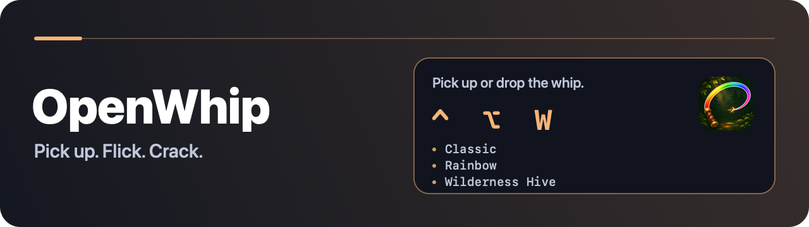

<p align="center">
  
</p>

<div align="center">
  <h1>OpenWhip for macOS</h1>
  <p>A native menu bar toy with rope physics, synthesized sound, and an optional nudge for your AI workspace.</p>
  <p><a href="https://github.com/muddgrrrl/OpenWhip-Mac/releases/latest"><strong>Download for macOS</strong></a> · <a href="#build-from-source">Build from source</a></p>
  <p>macOS 13+ · Apple silicon and Intel</p>
</div>

## Get started

1. Download `OpenWhip.pkg` from the latest release, install it, and open **OpenWhip** from Applications. The package is unsigned and the app is ad-hoc signed. You can also build locally from the source below.
2. Left-click the menu bar icon or press **Control–Option–W** to pick up the whip.
3. Flick your pointer back and forth to crack it. Click the overlay or press the shortcut again to drop it.

## Settings

| Setting | Options |
| --- | --- |
| Style | Classic, animated Rainbow, or amber-and-pine Wilderness Hive |
| Difficulty | Easy, Standard, or Hard |
| Sound | Synthesized crack, with a silent mode |
| Message | Default, themed presets, or your own text |

Right-click the menu bar icon and choose **Misc…** to change these settings. Changes apply on the next pickup.

## Send an optional nudge

1. Right-click the menu bar icon and choose **Allow [app]…**, or use **Settings → Add Application…**. Select the app that hosts your input, such as **ChatGPT.app** for Codex inside ChatGPT.
2. In OpenWhip Settings, choose **Open Accessibility Settings** and enable **OpenWhip** in **Privacy & Security → Accessibility**.
3. Focus an empty composer in the allowed app, then pick up the whip. The first eligible crack submits the selected message. The default is “Go faster. Keep working on the current task.”

Delivery checks that the same app and window are still in front. **Chat** mode checks the focused input when the app exposes it to Accessibility. For Codex windows that do not expose a composer, focus the composer yourself before pickup. **Terminal** mode types into the active terminal pane. **Terminal + Ctrl-C** interrupts the running command before sending the message. Turn off **Send chat nudges** in **Misc…** for animation and sound only.

<details>
<summary>Keyboard delivery checks</summary>

- **Control–Option–T** types `openwhip test` without submitting it.
- **Control–Option–P** tests standard paste and restores the previous clipboard if it has not changed.
- For a virtual keyboard check, copy [the optional Karabiner rule](Keyboard/OpenWhip-Codex-Keyboard.json) to `~/.config/karabiner/assets/complex_modifications/`. Enable **OpenWhip virtual keyboard test for Codex** under **Complex Modifications**. Focus the Codex composer and press **Control–Option–K** to type the test string without submitting it.

</details>

## Build from source

With Apple’s command-line developer tools and Python 3 installed, run:

```sh
bash build.sh
```

The build compiles a universal binary, runs the built-in checks, signs the app locally, and writes `dist/OpenWhip.app` and `dist/OpenWhip.pkg`. From a graphical macOS session, run `dist/OpenWhip.app/Contents/MacOS/OpenWhip --smoke-test` to exercise the settings and overlay windows.

## Credits

Inspired by [GitFrog1111’s OpenWhip](https://github.com/GitFrog1111/OpenWhip). This macOS implementation uses Swift and AppKit, its own rope simulation, and a synthesized crack.
